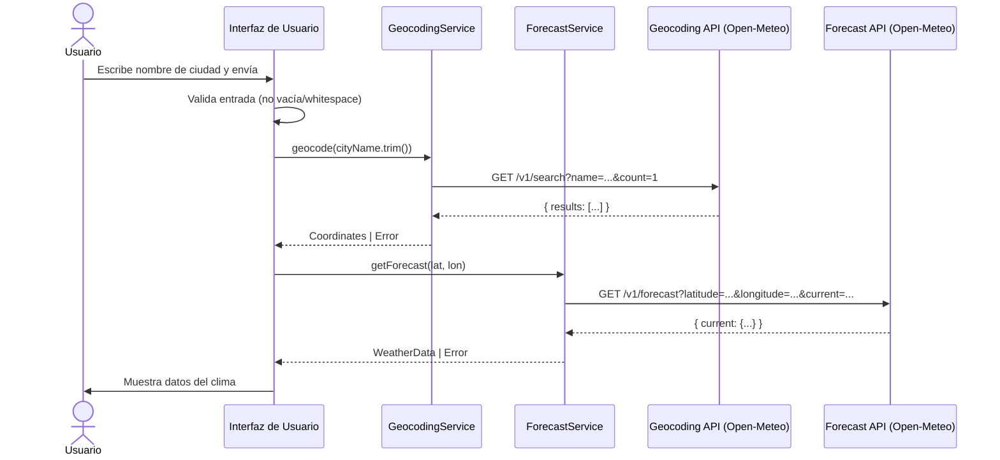
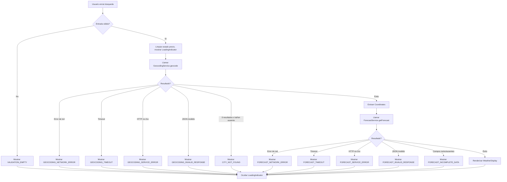

# Documento de Diseño Técnico

## Introducción

Este documento describe el diseño técnico de la aplicación web **weather-forecast-app**. La aplicación permite al usuario ingresar el nombre de una ciudad y obtener el pronóstico climático actual (temperatura, humedad y precipitaciones), utilizando las APIs públicas y gratuitas de [Open-Meteo](https://open-meteo.com).

---

## Overview

La aplicación es una Single Page Application (SPA) estática, sin backend propio. Todo el procesamiento ocurre en el navegador del usuario. El flujo principal consta de tres etapas secuenciales:

1. El usuario ingresa el nombre de una ciudad.
2. La app convierte el nombre en coordenadas geográficas mediante la **Geocoding API** de Open-Meteo.
3. Con las coordenadas, la app consulta la **Forecast API** de Open-Meteo y muestra los resultados.



---

## Architecture

La arquitectura sigue el patrón **Separación de Responsabilidades** en capas claramente delimitadas dentro del cliente:

```
┌─────────────────────────────────────────────────────────┐
│                   Capa de Presentación                   │
│  CitySearchForm  │  WeatherDisplay  │  LoadingIndicator  │
│                  │   ErrorMessage   │                    │
└──────────────────────────┬──────────────────────────────┘
                           │ eventos / callbacks
┌──────────────────────────▼──────────────────────────────┐
│                   Capa de Aplicación                     │
│              WeatherController (orquestador)             │
└──────────┬───────────────────────────────┬──────────────┘
           │                               │
┌──────────▼──────────┐       ┌────────────▼───────────────┐
│  GeocodingService   │       │    ForecastService          │
│  - geocode(name)    │       │  - getForecast(lat, lon)    │
└──────────┬──────────┘       └────────────┬───────────────┘
           │                               │
┌──────────▼──────────┐       ┌────────────▼───────────────┐
│  GeocodingClient    │       │    ForecastClient           │
│  (HTTP fetch)       │       │    (HTTP fetch)             │
└─────────────────────┘       └────────────────────────────┘
```

**Decisiones de diseño:**

- **Sin framework pesado:** La app usa HTML, CSS y JavaScript/TypeScript vanilla para mantener el bundle mínimo y evitar dependencias innecesarias. Se puede adoptar un framework ligero (React, Svelte) sin cambiar las capas de servicio.
- **Sin backend propio:** Las APIs de Open-Meteo son gratuitas, no requieren API key y soportan CORS, por lo que las llamadas se hacen directamente desde el browser.
- **Separación servicio/cliente HTTP:** El `GeocodingService` y `ForecastService` orquestan la lógica de negocio (validación, parseo, manejo de errores); los clientes HTTP solo se encargan de la comunicación de red. Esto facilita el testing con mocks.
- **Timeout de 10 segundos:** Implementado con `AbortController` y `setTimeout` en ambos clientes HTTP, conforme al Requisito 2.4 y 3.3.

---

## Components and Interfaces

### Componentes de UI

#### `CitySearchForm`
- Renderiza el campo `City_Input` con `maxlength="100"`.
- Renderiza el botón de envío.
- Maneja el evento `submit` del formulario y el evento `keydown` para la tecla Enter.
- Muestra mensajes de validación inline cuando la entrada está vacía o es solo whitespace.
- Emite un evento `search(cityName: string)` hacia el controlador.

#### `WeatherDisplay`
- Renderiza los datos del clima: nombre de ciudad, temperatura (°C), humedad (%) y precipitación (mm).
- Aplica el formateo numérico: temperatura y precipitación a máximo 1 decimal; humedad como entero.
- Se limpia al inicio de cada nueva búsqueda.
- Muestra el nombre ingresado por el usuario como fallback si la Geocoding API no retorna un nombre.

#### `LoadingIndicator`
- Componente simple que se muestra/oculta según el estado de la solicitud en curso.

#### `ErrorMessage`
- Muestra mensajes de error descriptivos según el tipo de fallo (validación, ciudad no encontrada, servicio no disponible, datos incompletos).

### Servicios

#### `GeocodingService`

```typescript
interface Coordinates {
  latitude: number;
  longitude: number;
  cityName: string; // nombre retornado por la Geocoding API
}

type GeocodingResult = 
  | { success: true; data: Coordinates }
  | { success: false; error: GeocodingError };

type GeocodingError =
  | { type: 'CITY_NOT_FOUND' }
  | { type: 'NETWORK_ERROR' }
  | { type: 'TIMEOUT' }
  | { type: 'SERVICE_ERROR'; statusCode: number }
  | { type: 'INVALID_RESPONSE' };

interface GeocodingService {
  geocode(cityName: string): Promise<GeocodingResult>;
}
```

#### `ForecastService`

```typescript
interface WeatherData {
  temperature: number;    // temperature_2m en °C (valor crudo)
  humidity: number;       // relative_humidity_2m en % (valor crudo)
  precipitation: number;  // precipitation en mm (valor crudo)
}

type ForecastResult =
  | { success: true; data: WeatherData }
  | { success: false; error: ForecastError };

type ForecastError =
  | { type: 'NETWORK_ERROR' }
  | { type: 'TIMEOUT' }
  | { type: 'SERVICE_ERROR'; statusCode: number }
  | { type: 'INCOMPLETE_DATA' }
  | { type: 'INVALID_RESPONSE' };

interface ForecastService {
  getForecast(lat: number, lon: number): Promise<ForecastResult>;
}
```

#### `WeatherController`
- Orquesta el flujo completo: valida la entrada, llama a `GeocodingService`, luego a `ForecastService`, y actualiza el estado de la UI.
- Gestiona el estado de carga (`isLoading`), errores y datos del clima.
- Limpia el `WeatherDisplay` al iniciar cada nueva búsqueda.

---

## Data Models

### Respuesta de la Geocoding API

La API retorna un objeto JSON con la siguiente estructura:

```json
{
  "results": [
    {
      "id": 2950159,
      "name": "Berlin",
      "latitude": 52.52437,
      "longitude": 13.41053,
      "country": "Deutschland",
      "country_code": "DE",
      "admin1": "Berlin"
    }
  ]
}
```

- Si no hay resultados, el campo `results` puede estar ausente o ser un array vacío.
- Los campos vacíos no son retornados por la API (ej. `admin4` se omite si no hay cuarto nivel administrativo).
- Si `latitude` o `longitude` están ausentes en el primer resultado, se trata como "ciudad no encontrada".

**Mapeo a `Coordinates`:**

| Campo API               | Campo interno    | Transformación         |
|-------------------------|------------------|------------------------|
| `results[0].latitude`   | `latitude`       | Sin modificación       |
| `results[0].longitude`  | `longitude`      | Sin modificación       |
| `results[0].name`       | `cityName`       | Sin modificación       |

### Respuesta de la Forecast API

La URL de solicitud tiene la forma:

```
https://api.open-meteo.com/v1/forecast
  ?latitude={lat}
  &longitude={lon}
  &current=temperature_2m,relative_humidity_2m,precipitation
```

> **Nota:** El parámetro moderno de la API usa `relative_humidity_2m` (con guion bajo completo). El requirements.md usa el nombre legacy `relativehumidity_2m`; en la implementación se usará el nombre actual de la API para garantizar compatibilidad.

La API retorna:

```json
{
  "latitude": 52.52,
  "longitude": 13.42,
  "generationtime_ms": 0.123,
  "utc_offset_seconds": 0,
  "timezone": "GMT",
  "current_units": {
    "time": "iso8601",
    "temperature_2m": "°C",
    "relative_humidity_2m": "%",
    "precipitation": "mm"
  },
  "current": {
    "time": "2024-01-15T12:00",
    "temperature_2m": 8.4,
    "relative_humidity_2m": 72,
    "precipitation": 0.0
  }
}
```

**Mapeo a `WeatherData`:**

| Campo API                         | Campo interno  | Transformación         |
|-----------------------------------|----------------|------------------------|
| `current.temperature_2m`          | `temperature`  | Sin modificación       |
| `current.relative_humidity_2m`    | `humidity`     | Sin modificación       |
| `current.precipitation`           | `precipitation`| Sin modificación       |

Los valores se almacenan **sin transformación**. El formateo (decimales) se aplica únicamente en la capa de presentación al momento de renderizar.

### Reglas de Formateo para la Presentación

| Campo         | Regla de formato                              | Ejemplo          |
|---------------|-----------------------------------------------|------------------|
| Temperatura   | Máximo 1 decimal + unidad "°C"               | `8.4 °C`         |
| Humedad       | Número entero (sin decimales) + unidad "%"   | `72 %`           |
| Precipitación | Máximo 1 decimal + unidad "mm"               | `0.0 mm`         |

Implementación de formateo:
- Temperatura: `value.toFixed(1) + ' °C'`
- Humedad: `Math.round(value) + ' %'`
- Precipitación: `value.toFixed(1) + ' mm'`

### Estados de la Aplicación

```typescript
type AppState =
  | { status: 'idle' }
  | { status: 'loading' }
  | { status: 'success'; cityName: string; weather: WeatherData }
  | { status: 'error'; message: string };
```

---

## Correctness Properties

*Una propiedad es una característica o comportamiento que debe ser verdadero en todas las ejecuciones válidas de un sistema — esencialmente, un enunciado formal sobre lo que el sistema debe hacer. Las propiedades sirven como puente entre especificaciones legibles por humanos y garantías de corrección verificables por máquinas.*

### Property 1: Rechazo de entradas de solo whitespace

*Para cualquier* string compuesto únicamente de caracteres de espacio en blanco (incluyendo el string vacío, espacios, tabs y combinaciones), cuando el usuario intente enviar ese valor como nombre de ciudad, la aplicación DEBERÁ rechazarlo mostrando un mensaje de validación y NO DEBERÁ emitir ninguna solicitud a la Geocoding API.

**Validates: Requirements 1.3, 1.4, 2.5**

---

### Property 2: Trim del nombre de ciudad antes de enviar

*Para cualquier* string de nombre de ciudad que contenga espacios al inicio o al final (pero que tenga al menos un carácter no-whitespace), el valor enviado como parámetro `name` a la Geocoding API DEBERÁ ser igual al resultado de aplicar `trim()` al valor ingresado por el usuario.

**Validates: Requirements 1.5**

---

### Property 3: Construcción correcta de la URL de Geocodificación

*Para cualquier* nombre de ciudad no vacío, la URL construida para la solicitud a la Geocoding API DEBERÁ contener el nombre URL-encoded como parámetro `name` y el parámetro `count=1`.

**Validates: Requirements 2.1**

---

### Property 4: Extracción de coordenadas del primer resultado

*Para cualquier* respuesta válida de la Geocoding API que contenga uno o más resultados con `latitude` y `longitude` presentes, las coordenadas extraídas DEBERÁN ser numéricamente iguales a los valores `latitude` y `longitude` del primer elemento del array `results`, sin ninguna transformación.

**Validates: Requirements 2.2, 5.1**

---

### Property 5: Validación de campos de coordenadas faltantes

*Para cualquier* resultado de la Geocoding API donde el campo `latitude` o el campo `longitude` (o ambos) sea `null`, `undefined` o esté ausente, la extracción de coordenadas DEBERÁ producir un resultado inválido que sea tratado como "ciudad no encontrada".

**Validates: Requirements 2.6**

---

### Property 6: Construcción correcta de la URL de Pronóstico

*Para cualquier* par de coordenadas válidas (latitud ∈ [-90, 90], longitud ∈ [-180, 180]), la URL construida para la Forecast API DEBERÁ contener los parámetros `latitude`, `longitude` y el parámetro `current` con los nombres de variables `temperature_2m`, `relative_humidity_2m` y `precipitation`.

**Validates: Requirements 3.1**

---

### Property 7: Round-trip de parseo de la respuesta Forecast → WeatherData

*Para cualquier* respuesta JSON válida de la Forecast API que contenga los campos `current.temperature_2m`, `current.relative_humidity_2m` y `current.precipitation` con valores numéricos, los valores almacenados en el objeto `WeatherData` interno DEBERÁN ser numéricamente iguales a los valores del JSON crudo, sin ninguna transformación antes del almacenamiento.

**Validates: Requirements 3.2, 5.2**

---

### Property 8: Respuestas HTTP no-2xx siempre generan error

*Para cualquier* código de estado HTTP en el rango [300–599] retornado por la Geocoding API o la Forecast API, la aplicación DEBERÁ tratar la respuesta como un fallo e indicar en el mensaje de error cuál servicio falló.

**Validates: Requirements 3.4, 5.4**

---

### Property 9: Respuestas 2xx con cuerpo inválido generan error

*Para cualquier* respuesta HTTP 2xx de la Geocoding API o la Forecast API cuyo cuerpo no pueda ser parseado al objeto esperado (`Coordinates` o `WeatherData`), la aplicación DEBERÁ mostrar un mensaje de error indicando que los datos recibidos no son válidos.

**Validates: Requirements 5.5**

---

### Property 10: Campos meteorológicos faltantes generan error de datos incompletos

*Para cualquier* respuesta de la Forecast API donde al menos uno de los campos `current.temperature_2m`, `current.relative_humidity_2m` o `current.precipitation` sea `null`, `undefined` o esté ausente, la aplicación DEBERÁ mostrar un mensaje de error indicando que los datos meteorológicos están incompletos.

**Validates: Requirements 3.5**

---

### Property 11: Formateo numérico correcto de los valores del clima

*Para cualquier* valor numérico de temperatura y precipitación, la representación formateada en la interfaz DEBERÁ tener como máximo 1 dígito decimal. *Para cualquier* valor numérico de humedad, la representación formateada DEBERÁ ser un número entero (sin decimales).

**Validates: Requirements 5.3**

---

### Property 12: Weather_Display contiene todos los campos con sus unidades

*Para cualquier* objeto `WeatherData` válido, el `Weather_Display` renderizado DEBERÁ contener: el nombre de la ciudad, el valor de temperatura seguido de "°C", el valor de humedad seguido de "%", y el valor de precipitación seguido de "mm".

**Validates: Requirements 4.1, 4.2, 4.3, 4.4**

---

### Property 13: Limpieza del Weather_Display al iniciar nueva búsqueda

*Para cualquier* estado del `Weather_Display` que contenga datos de una búsqueda previa, al iniciar una nueva búsqueda, el contenido del `Weather_Display` DEBERÁ estar limpio antes de que llegue la respuesta de la nueva solicitud a la Forecast API.

**Validates: Requirements 4.6**

---

## Error Handling

### Clasificación de Errores

| Tipo de Error                    | Causa                                                    | Mensaje al Usuario                                                    |
|----------------------------------|----------------------------------------------------------|-----------------------------------------------------------------------|
| `VALIDATION_EMPTY`               | City_Input vacío o solo whitespace                       | "El nombre de la ciudad es obligatorio."                             |
| `CITY_NOT_FOUND`                 | Geocoding API retorna 0 resultados o campos lat/lon nulos | "No se encontró la ciudad ingresada. Verifica el nombre e intenta de nuevo." |
| `GEOCODING_NETWORK_ERROR`        | Error de red en solicitud a Geocoding API               | "El servicio de geocodificación no está disponible. Verifica tu conexión." |
| `GEOCODING_TIMEOUT`              | Geocoding API no responde en 10 segundos                | "El servicio de geocodificación no respondió a tiempo."              |
| `GEOCODING_SERVICE_ERROR`        | Geocoding API retorna HTTP no-2xx                       | "El servicio de geocodificación retornó un error."                   |
| `GEOCODING_INVALID_RESPONSE`     | Cuerpo de respuesta no parseable                        | "Los datos recibidos del servicio de geocodificación no son válidos."|
| `FORECAST_NETWORK_ERROR`         | Error de red en solicitud a Forecast API                | "El servicio de pronóstico no está disponible. Verifica tu conexión."|
| `FORECAST_TIMEOUT`               | Forecast API no responde en 10 segundos                 | "El servicio de pronóstico no respondió a tiempo."                   |
| `FORECAST_SERVICE_ERROR`         | Forecast API retorna HTTP no-2xx                        | "El servicio de pronóstico retornó un error."                        |
| `FORECAST_INCOMPLETE_DATA`       | Algún campo del clima es null o está ausente            | "Los datos meteorológicos recibidos están incompletos."              |
| `FORECAST_INVALID_RESPONSE`      | Cuerpo de respuesta no parseable                        | "Los datos recibidos del servicio de pronóstico no son válidos."     |

### Estrategia de Manejo de Errores

1. **Validación antes de cualquier llamada de red:** La validación de la entrada (vacía/whitespace) se realiza de forma sincrónica en el cliente antes de iniciar cualquier solicitud HTTP.
2. **Timeout con `AbortController`:** Cada cliente HTTP crea un `AbortController` con un timeout de 10 segundos. Al superarse, se cancela la solicitud y se reporta el error de tipo `TIMEOUT`.
3. **Verificación de código HTTP:** Tras recibir la respuesta, se verifica `response.ok`. Si es `false`, se genera un error de tipo `SERVICE_ERROR` con el código de estado.
4. **Validación del cuerpo parseado:** El parseo del JSON se realiza dentro de un bloque `try/catch`. Si falla, se genera `INVALID_RESPONSE`. Si tiene éxito pero los campos requeridos están ausentes o nulos, se genera el error correspondiente (`CITY_NOT_FOUND`, `INCOMPLETE_DATA`).
5. **Preservación del acceso a City_Input:** Ante cualquier error, el campo `City_Input` permanece habilitado y enfocado para permitir reintentos.
6. **Limpieza de estado en nueva búsqueda:** Al iniciar una nueva búsqueda, el estado de error previo y el `WeatherDisplay` previo se limpian antes de emitir las nuevas solicitudes.

### Flujo de Manejo de Errores



---

## Testing Strategy

### Enfoque Dual: Pruebas de Ejemplo + Pruebas Basadas en Propiedades

La estrategia combina pruebas de ejemplo (para escenarios concretos y casos de borde) con pruebas basadas en propiedades (para validar invariantes universales a través de entradas generadas aleatoriamente).

### Framework de Testing

- **Pruebas unitarias y de propiedades:** [Vitest](https://vitest.dev/) como test runner.
- **Pruebas basadas en propiedades:** [fast-check](https://fast-check.io/) como biblioteca de property-based testing.
- **Pruebas de componentes UI:** Vitest + [Testing Library](https://testing-library.com/) (DOM).

### Configuración de Pruebas de Propiedades

Cada prueba de propiedad se ejecuta con un mínimo de **100 iteraciones** (configuración predeterminada de fast-check). Cada prueba lleva una etiqueta de referencia al documento de diseño:

```typescript
// Formato de etiqueta:
// Feature: weather-forecast-app, Propiedad {N}: {texto de la propiedad}
```

### Cobertura de Pruebas

#### Pruebas Basadas en Propiedades (Property-Based Tests)

Cada propiedad de corrección definida en este documento se implementa como una prueba de propiedad única:

| Propiedad | Generadores de Entrada | Biblioteca |
|-----------|------------------------|------------|
| P1: Rechazo de whitespace | `fc.stringOf(fc.constantFrom(' ', '\t', '\n', '\r'))` | fast-check |
| P2: Trim antes de enviar | Strings con whitespace en extremos + contenido válido | fast-check |
| P3: URL de Geocodificación | Strings arbitrarios no vacíos | fast-check |
| P4: Extracción de coordenadas | Objetos de respuesta con `latitude`/`longitude` numéricos | fast-check |
| P5: Coordenadas faltantes | Objetos con `latitude`/`longitude` nulos o ausentes | fast-check |
| P6: URL de Forecast | Pares `(lat, lon)` ∈ [-90, 90] × [-180, 180] | fast-check |
| P7: Round-trip parseo Forecast | Objetos de respuesta Forecast con valores numéricos | fast-check |
| P8: HTTP no-2xx → error | Códigos de estado ∈ [300, 599] para ambas APIs | fast-check |
| P9: 2xx con cuerpo inválido → error | Strings/objetos malformados o sin campos requeridos | fast-check |
| P10: Campos nulos → incompletos | Combinaciones de campos nulos/ausentes en `current` | fast-check |
| P11: Formateo numérico | Valores `number` arbitrarios (incluyendo decimales) | fast-check |
| P12: Weather_Display contiene campos | Objetos `WeatherData` arbitrarios válidos | fast-check |
| P13: Limpieza de display | Cualquier estado previo de `WeatherDisplay` | fast-check |

#### Pruebas de Ejemplo (Unit Tests)

| Escenario | Tipo |
|-----------|------|
| Renderizado del campo City_Input con maxlength=100 | Ejemplo |
| Envío con clic en botón | Ejemplo |
| Envío con tecla Enter en City_Input | Ejemplo |
| Geocoding API retorna 0 resultados → mensaje "ciudad no encontrada" | Ejemplo |
| Geocoding API: error de red | Ejemplo |
| Geocoding API: timeout (mock 10s) | Ejemplo |
| Forecast API: error de red | Ejemplo |
| Forecast API: timeout (mock 10s) | Ejemplo |
| Indicador de carga aparece al iniciar y desaparece al completar | Ejemplo |
| Fallback a nombre ingresado por usuario si cityName está vacío en respuesta | Ejemplo |
| City_Input permanece accesible después de cualquier error | Ejemplo |

### Estructura de Archivos de Test

```
src/
├── services/
│   ├── GeocodingService.test.ts     # Pruebas de servicio (unit + property)
│   └── ForecastService.test.ts      # Pruebas de servicio (unit + property)
├── utils/
│   └── formatters.test.ts           # Pruebas de formateo (property P11)
└── components/
    ├── CitySearchForm.test.ts        # Pruebas de componente UI
    └── WeatherDisplay.test.ts        # Pruebas de componente UI (property P12, P13)
```
